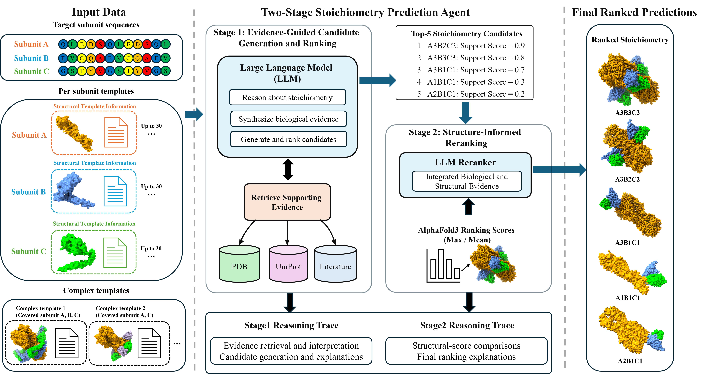

# StoiAgent

StoiAgent predicts the stoichiometry of a protein complex, meaning how many copies of each subunit it contains, from the subunit sequences in a FASTA file. It searches for structural templates, uses an LLM to propose and rank candidate stoichiometries from the template and literature evidence, models the top candidates with AlphaFold 3 (AF3), and reranks them. The result is saved as `final_prediction.json`.



## Requirements

- Linux with one NVIDIA GPU with **80 GB** of memory, such as an A100 80GB or H100 80GB
- Docker with the NVIDIA Container Toolkit (or Singularity), to run AF3
- 64 GB RAM, about 1 TB of free disk, and internet access

See [System requirements](#system-requirements) for details.

## Quick start

**1. Install the environment.** You need `mamba`. If you don't have it, see [Installing Miniforge](#installing-miniforge).

```bash
git clone https://github.com/BioinfoMachineLearning/StoiAgent.git
cd StoiAgent
mamba env create -f environment.yml
mamba activate stoiagent
```

**2. Download the databases and AF3 model parameters** (about 700 GB; rerun the command if it is interrupted):

```bash
scripts/setup_databases.sh
```

The AF3 model parameters are subject to Google DeepMind's [terms of use](https://github.com/google-deepmind/alphafold3/blob/main/WEIGHTS_TERMS_OF_USE.md); review them before running the script.

**3. Build the AF3 Docker image:**

```bash
docker build -t stoiagent-alphafold3 -f tools/alphafold3/docker/Dockerfile tools/alphafold3
```

**4. Run a prediction:**

```bash
stoiagent --input_fasta examples/casp16/H0208.fasta --output_dir results/H0208
```

The first run also downloads the LLM weights (about 63 GB).

## Running StoiAgent

### Input

A FASTA file with one record per **distinct** protein subunit. StoiAgent names the subunits A, B, C, … in the order of the records. Identical sequences are merged, so a homomer can be given as a single record.

```text
>subunit_1
MSVTSQTSSSGSAAVSDCHRGIIDISGPVPGYEWEPSMTTEPVRGRVW...
>subunit_2
MTGRQRTTVVAPDRPVQDATISQLTTRVWTVAIDGYRTIVVEGETGIV...
```

### Command

```bash
stoiagent \
  --input_fasta complex.fasta \
  --output_dir results/complex \
  --description "Protein complex name" \
  --organism "Organism name"
```

| Option | Default | Meaning |
|---|---|---|
| `--input_fasta` | required | Input FASTA |
| `--output_dir` | required | Folder for all results. Use a separate folder for each complex. |
| `--description` | FASTA file name | Short description of the complex, given to the LLM |
| `--organism` | unspecified | Source organism, given to the LLM |
| `--model` | `Qwen3.6-27B` | LLM backbone (see [LLM weights](#llm-weights)) |
| `--k` | 5 | Number of candidates modeled with AF3 and reranked |
| `--num_models` | 100 | AF3 models per candidate (a multiple of 5) |
| `--config` | `config.json` | Configuration file (see [Configuration](#configuration)) |

### Output

`results/complex/final_prediction.json` holds the prediction:

```json
{
  "top1_stoichiometry": "A1B1",
  "ranked_stoichiometries": ["A1B1", "A2B2", "A1B2", "A2B1", "A3B3"],
  "stage1_candidates": ["A1B1", "A2B2", "A2B1", "A1B2", "A3B3"],
  "af3_scores_csv": ".../stoichiometry_results.csv",
  "stage2_result": ".../H0001_subunit_phase2_result.json"
}
```

`A2B1` means two copies of subunit A and one copy of subunit B. The output folder also contains the template searches, the AF3 models and the reasoning traces of both stages.

## Example datasets

`examples/` contains ready-to-run inputs for the stoichiometry-blind protein targets of CASP16 and CASP17, along with their true stoichiometries:

| Dataset | Targets | Input FASTA files | True stoichiometries |
|---|---|---|---|
| CASP16 | 28 | `examples/casp16/` | `examples/casp16_stoichiometry.csv` |
| CASP17 | 56 | `examples/casp17/` | `examples/casp17_stoichiometry.csv` |

```bash
stoiagent --input_fasta examples/casp17/H1312.fasta --output_dir results/H1312
```

See [CASP dataset details](#casp-dataset-details) for how the datasets were built.

---

# Reference

## System requirements

| Component | Requirement |
|---|---|
| Operating system | Linux, x86_64 |
| GPU | One NVIDIA GPU with **80 GB** of memory and compute capability 8.0 or higher, such as an A100 80GB or H100 80GB |
| GPU driver | NVIDIA driver 525 or newer |
| Container runtime | Docker with the NVIDIA Container Toolkit, or Singularity/Apptainer, to run AF3 |
| CPU | 8 or more cores (template search runs `jackhmmer` with 8 threads by default) |
| RAM | 64 GB or more |
| Disk | About 1 TB free, preferably SSD (see below) |
| Network | Internet access for setup, and during predictions for the RCSB, UniProt and PubMed queries that Stage 1 makes |

The GPU needs 80 GB because the default backbone, Qwen3.6-27B, takes about 54 GB in 16-bit precision before any working memory, and AF3 needs the full 80 GB for complexes near StoiAgent's 5,000-residue limit. The LLM stages and AF3 run one after another, so a single GPU is enough.

| Disk use | Size |
|---|---|
| AF3 genetic databases | about 630 GB |
| AF3 model parameters | about 1 GB |
| Default LLM weights (Qwen3.6-27B and Qwen3-4B) | about 63 GB |
| Template metadata and HHsearch database | about 57 GB, plus about 30 GB temporarily during setup |
| `stoiagent` environment | about 6 GB |
| AF3 Docker image | about 10 GB |

Each prediction also writes its template searches, AF3 models and reasoning traces to its output directory.

## Installing Miniforge

[Miniforge](https://github.com/conda-forge/miniforge) provides `mamba`:

```bash
curl -L -O "https://github.com/conda-forge/miniforge/releases/latest/download/Miniforge3-$(uname)-$(uname -m).sh"
bash "Miniforge3-$(uname)-$(uname -m).sh"
```

Accept the license, choose the install location (the default is `~/miniforge3`), and answer `yes` when asked whether to initialize the shell. Then open a new terminal, or run `source ~/.bashrc`, and check that `mamba --version` works.

## The environment

`environment.yml` creates the `stoiagent` environment. It contains Python, StoiAgent itself as an editable install, its Python dependencies from `pyproject.toml`, and the template-search programs `jackhmmer` (HMMER), `hhmake` and `hhsearch` (HH-suite). After pulling new changes, run `mamba env update -f environment.yml` to pick up new dependencies.

`python -m stoiagent` is equivalent to `stoiagent`. The optional Mistral backbone also needs `python -m pip install -e '.[mistral]'` inside the environment.

## Databases and tools

`scripts/setup_databases.sh` downloads the HHsearch template database and the template metadata (about 33 GB), clones AF3, and downloads the AF3 model parameters (about 1 GB) and the AF3 databases (about 630 GB). Everything goes to the default locations below, so StoiAgent finds it without a configuration file. Downloads resume where they stopped. Options:

- `--db-dir /big/disk/stoiagent_db` puts the databases on another disk and records their paths in `config.json` in this folder. StoiAgent reads that file automatically.
- `--only templates` or `--only af3` sets up just one part.

When it finishes, the script lists the steps it cannot do for you, such as building the AF3 Docker image. If a resource is still missing when you run StoiAgent, it stops before the step that needs it and lists the missing paths.

```text
StoiAgent/
  tools/
    alphafold3/             AF3 source checkout                       (setup script)
      models/af3.bin.zst    AF3 model parameters                      (setup script)
    alphafold3.sif          AF3 Singularity image, Singularity only   (manual)
  databases/
    af3/                    AF3 genetic databases, incl. UniRef90     (setup script)
    sort90_hhsuitedb/       HHsearch template database (prefix hhsuitedb3) (setup script)
    templates/              template metadata                         (setup script)
      entity_fasta/
      entity_metadata/
      chain_atoms/
      pdb_stoichiometry.csv
```

Git ignores `databases/`, `tools/` and `config.json`.

### AlphaFold 3

The setup script clones AF3 into `tools/alphafold3`, downloads the [AF3 model parameters](https://github.com/google-deepmind/alphafold3/blob/main/docs/installation.md#obtaining-model-parameters) to `tools/alphafold3/models/af3.bin.zst`, and downloads its databases to `databases/af3`. AF3 reads the compressed parameters directly. The rest follows the [official AlphaFold 3 installation guide](https://github.com/google-deepmind/alphafold3/blob/main/docs/installation.md):

1. Install Docker, the NVIDIA driver, and the NVIDIA Container Toolkit as described in the official guide. Check `nvidia-smi` and that a GPU-enabled Docker container can see the GPU.
2. Review the [terms of use](https://github.com/google-deepmind/alphafold3/blob/main/WEIGHTS_TERMS_OF_USE.md) of the AF3 model parameters. The parameters are not included in this repository; the setup script downloads them from Google.
3. Build the official image and run the official sample prediction to verify the installation:

   ```bash
   docker build -t stoiagent-alphafold3 -f tools/alphafold3/docker/Dockerfile tools/alphafold3
   ```

With Docker, StoiAgent runs AF3 as your own user (`docker run --user`), so its outputs belong to you, and mounts `tools/alphafold3/models` at `/models`, the AF3 databases at `/public_databases` and the AF3 output folder at `/af_output` inside the container. If an AF3 output folder still contains files owned by root, for example from an older run, StoiAgent hands them back to you after the next AF3 job. To use Singularity instead, follow the [official Singularity instructions](https://github.com/google-deepmind/alphafold3/blob/main/docs/installation.md#running-using-singularity-instead-of-docker) to build `tools/alphafold3.sif`, and set `"af3_runtime": "singularity"` in `config.json`.

### Template search

Template search runs `jackhmmer`, `hhmake` and `hhsearch`, which the `stoiagent` environment provides. It uses the UniRef90 file from the AF3 databases. The setup script downloads the HHsearch template database and the template metadata, which turns HHsearch hits into stoichiometry evidence:

| File | Contents |
|---|---|
| `sort90_hhsuitedb/` | HHsearch database of PDB chain profiles (prefix `hhsuitedb3`), searched for templates of each subunit. |
| `entity_fasta/` | For each PDB entry, one FASTA record per distinct entity. Record IDs are the subunit letters used in that entry's stoichiometry. |
| `entity_metadata/` | For each PDB entry, the RCSB metadata: title, keywords, experimental method, resolution, citation and polymer entities. |
| `chain_atoms/` | Coordinates of each template chain, named after its HHsearch hit (PDB ID plus chain ID), such as `101MA.atom.gz`. They are used to recover each hit's sequence. |
| `pdb_stoichiometry.csv` | The assembly stoichiometry (`final_stoichiometry`) and `release_date` of each PDB entry. |

### LLM weights

StoiAgent loads its language models from Hugging Face. The weights download automatically on the first run and are reused afterwards.

| Model | `--model` | Role | Download |
|---|---|---|---|
| [Qwen3.6-27B](https://huggingface.co/Qwen/Qwen3.6-27B) | `Qwen3.6-27B` (default) | Stage 1 and Stage 2 reasoning | about 55 GB |
| [Qwen3-4B-Instruct-2507](https://huggingface.co/Qwen/Qwen3-4B-Instruct-2507) | always used | Literature summaries | about 8 GB |
| [Gemma-3-27B-it](https://huggingface.co/google/gemma-3-27b-it) | `Gemma-3-27B-it` | Alternative backbone | about 55 GB |
| [OLMo-2-32B-Instruct](https://huggingface.co/allenai/OLMo-2-0325-32B-Instruct) | `OLMo-2-32B-Instruct` | Alternative backbone | about 65 GB |
| [Mistral-Small-3.2-24B](https://huggingface.co/mistralai/Mistral-Small-3.2-24B-Instruct-2506) | `Mistral-Small-3.2-24B` | Alternative backbone, needs the `mistral` extra | about 50 GB |

- **Storage:** the weights go to the Hugging Face cache, `~/.cache/huggingface` by default. To keep them on a larger disk, set `export HF_HOME=/big/disk/huggingface` before running StoiAgent, for example in `~/.bashrc`.
- **Download in advance:** to download before the first run, for example on a login node with internet access, run `hf download Qwen/Qwen3.6-27B` and `hf download Qwen/Qwen3-4B-Instruct-2507` in the `stoiagent` environment.
- **Gated models:** Gemma is gated. Accept its license on its Hugging Face page, then run `hf auth login` once with a Hugging Face access token. The Qwen models need no login.

## Configuration

StoiAgent needs no configuration when everything is in its default location. To keep a resource outside this folder, for example a shared AF3 database, set only the paths that differ in `config.json` in this folder, which StoiAgent reads automatically. You can also pass another file with `--config`, which is then used instead of `config.json`. Relative paths are resolved against this folder. Set `STOIAGENT_HOME` to resolve the default locations against another folder instead.

```json
{
  "af3_db_path": "/shared/af3_databases",
  "uniref90_path": "/shared/af3_databases/uniref90_2022_05.fa",
  "af3_runtime": "singularity",
  "gpu_device": "1"
}
```

The available keys are `uniref90_path`, `hhdb_prefix`, `template_entity_fasta_dir`, `template_entity_metadata_dir`, `template_chain_atoms_dir`, `template_stoichiometry_csv`, `af3_program_path`, `af3_params_path`, `af3_db_path`, `af3_sif_path`, `af3_runtime` (`docker` or `singularity`), `af3_image` (default `stoiagent-alphafold3`), `gpu_device`, `jackhmmer_binary`, `hhmake_binary`, `hhsearch_binary` and `search_cpu`. The defaults are in `src/stoiagent/config.py`.

## How the pipeline works

1. **Template search.** For each subunit, `jackhmmer` searches UniRef90, `hhmake` builds a profile, and `hhsearch` finds PDB templates. The template metadata turns the hits into evidence such as the copy numbers seen in related structures.
2. **Stage 1.** The LLM reasons over the template evidence, reads relevant literature on demand, and proposes and ranks candidate stoichiometries over 15 stochastic samples.
3. **AF3.** AF3 models the top `--k` candidates that fit within its 5,000-residue and 26-chain limits. Candidates beyond those limits stay in the shortlist without AF3 scores.
4. **Stage 2.** The LLM reranks exactly that shortlist, combining the Stage-1 evidence with the AF3 ranking scores.

AF3 ranking scores are structural-confidence evidence, not probabilities that a stoichiometry is biologically correct. The template-search and AF3 results are reused when you rerun in the same output folder, so use a fresh output folder if the databases, models or configuration change.

## CASP dataset details

For the stoichiometry-blind targets, CASP first released only the subunit sequences, with the stoichiometry withheld ("UNK"). In the next phase it released the stoichiometry of the experimental structure, and the datasets use that as the true answer.

| Dataset | Targets | Heteromers (`H`) | Homomers (`T`) | Target IDs | True stoichiometry from |
|---|---|---|---|---|---|
| CASP16 | 28 | 19 | 9 | Phase 0: `H0xxx`, `T0xxx` | Phase 1: `H1xxx`, `T1xxx` |
| CASP17 | 56 | 43 | 13 | Phase 1: `H1xxx`, `T1xxx` | Phase 2: `H2xxx`, `T2xxx` |

Heteromers have 2–9 distinct subunits, and complexes range from 2 to 36 chains. The datasets leave out cancelled targets, targets that turned out to be monomers (`A1`), and targets whose stoichiometry CASP has not released.

```text
examples/
  casp16/<target>.fasta          input FASTA for each CASP16 target
  casp17/<target>.fasta          input FASTA for each CASP17 target
  casp16_stoichiometry.csv       true stoichiometries for CASP16
  casp17_stoichiometry.csv       true stoichiometries for CASP17
  casp16.HT1.seq.txt, casp17.HT1.seq.txt          CASP sequence releases
  casp16.targetlist.csv, casp17.targetlist.csv    Prediction Center target lists
  build_casp_examples.py         regenerates the FASTA files and tables
```

Each FASTA has one record per distinct subunit, in the order of the CASP sequence release, so the subunit letters match those in the true stoichiometry. The stoichiometry tables have these columns:

| Column | Meaning |
|---|---|
| `target` | Target ID, matching the FASTA file name |
| `stoichiometry` | True stoichiometry, such as `A2B2C2` (subunit A × 2, B × 2, C × 2) |
| `num_subunits` | Number of distinct subunits in the FASTA |
| `description`, `organism` | Target description and source organism from the CASP sequence release |
| `sequence_release_id` | ID of the target in the CASP sequence release |
| `stoichiometry_source` | CASP target whose released oligomeric state gives the true stoichiometry |

The CASP sequence releases do not always use the blind-phase ID. For example, the CASP16 release lists H0217 as H1217. The H/T letter and the last three digits identify a target, so the phase digit is swapped to get the blind-phase ID and the ID that carries the truth. This is the same mapping the stage modules use. Release entries with a suffix, such as `T1208s1` or `T1228v1`, are single subunits or variants of another target and are not included. To rebuild the datasets after updating the target lists, run `python examples/build_casp_examples.py`.

## Notes

Advanced research interfaces remain available with `python -m stoiagent.stage1_agent` and `python -m stoiagent.stage2_rerank`. The end-to-end command creates a local sequence catalog from the FASTA, so no CASP17 input file is needed. Its internal target ID is withheld from LLM prompts. For historical benchmark evaluation, supply the original target-release cutoffs and sequence release file to the standalone stage modules.

The adapted parser retains its original DeepMind copyright and Apache 2.0 notice. A copy of that license is in `APACHE-2.0-LICENSE.txt`.
